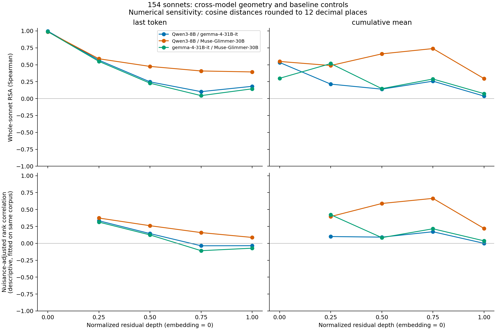
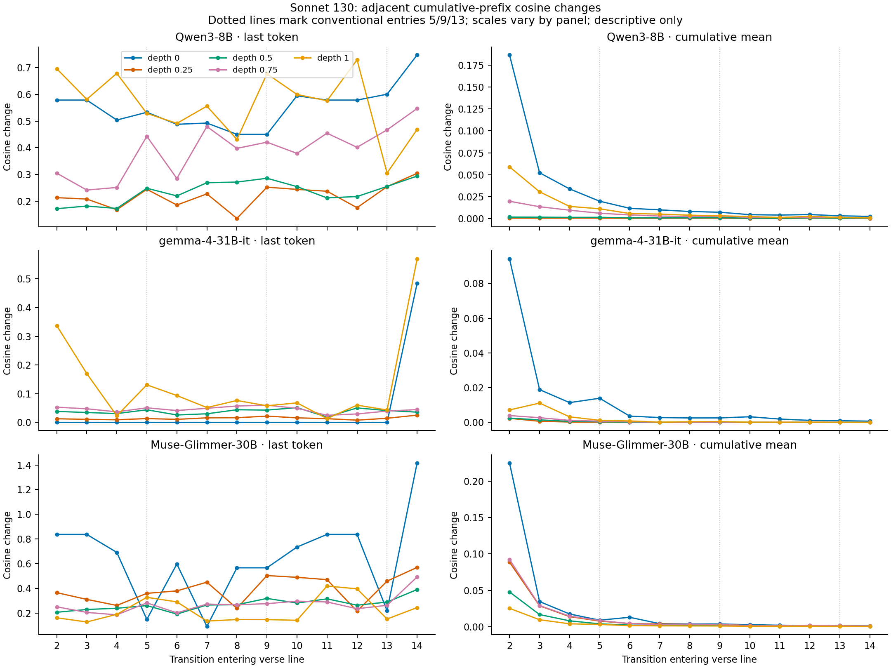
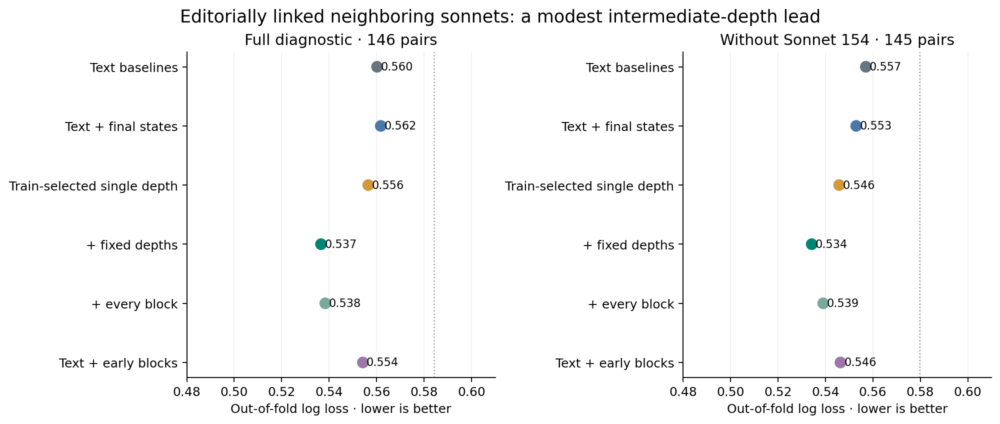
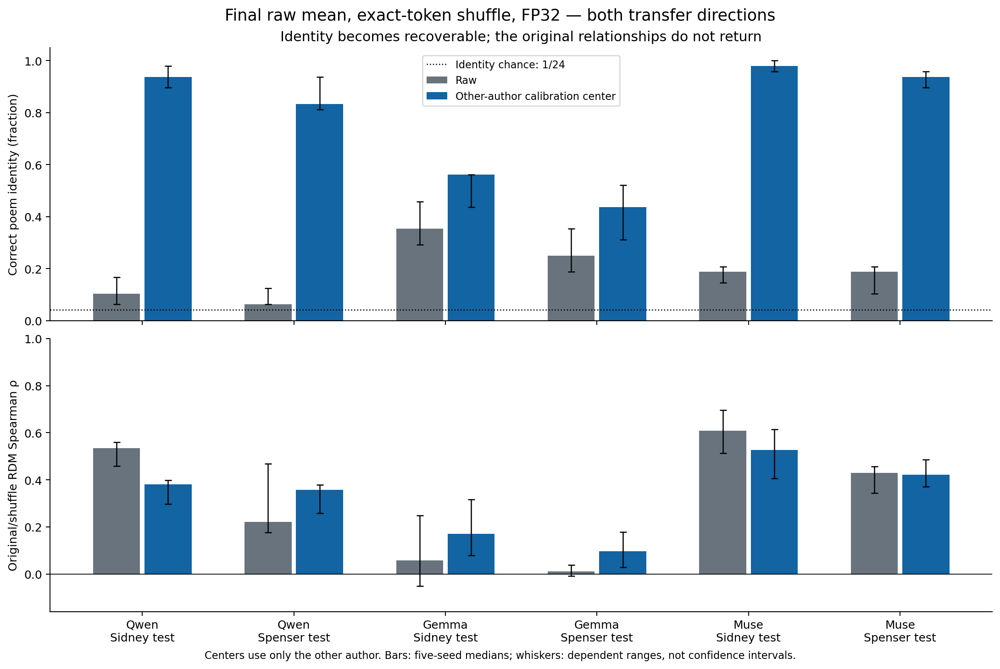
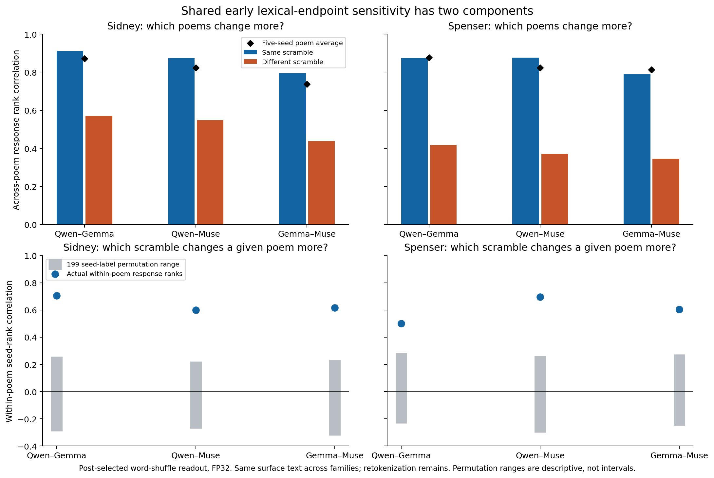
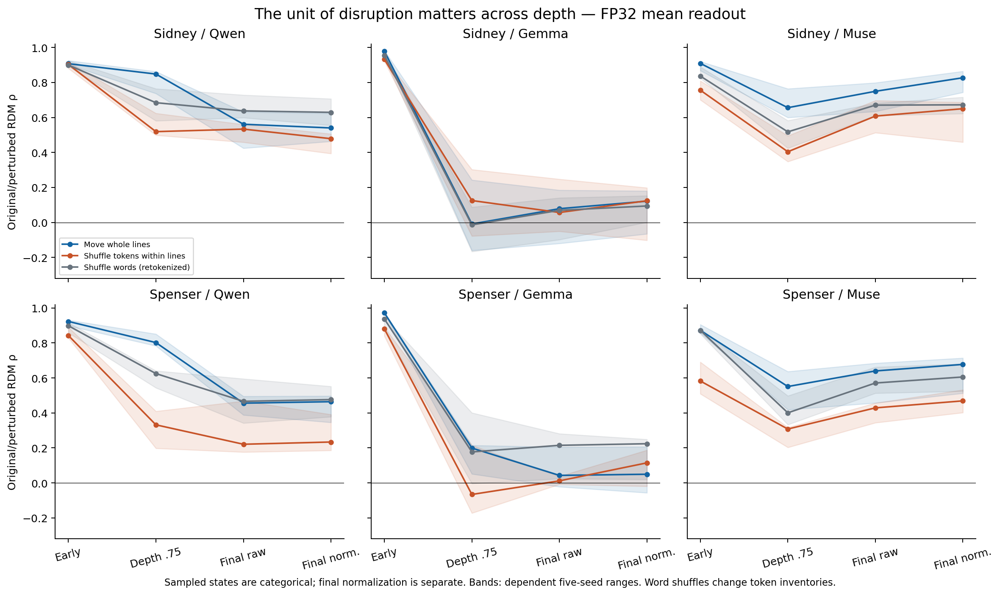

**Author:** Timothy O’Brien, The Shore. ORCID: https://orcid.org/0009-0001-2589-347X.

**Preprint:** not peer reviewed. Version 1.0.0. DOI: https://doi.org/10.5281/zenodo.23464450. Paper and original derived numeric data: CC BY 4.0; original software: MIT.

# Abstract

We distinguish recoverable poem identity, relational geometry, cross-model agreement and perturbation-response sensitivity in three transformer families. An original Shakespeare survey covers 154 sonnets; subsequent frozen tests use 24 Sidney and 24 Spenser sonnets with five randomizations and paired BF16/FP32 computations. Qwen and Gemma meet their early-versus-final depth criteria in both new populations; Muse misses the strength thresholds. An earlier selected Shakespeare increase in Qwen–Muse agreement fails to transfer, and neither new population meets the full frozen primary pattern. A subsequent five-round exploratory audit finds a different positive result: separate condition means estimated on one author substantially improve identification of shuffled poems in the other author, without generally restoring the original relational geometry. In Spenser final-raw means, Qwen identification rises from 6.3% to 83.3% and Muse from 18.8% to 93.8%, among 24 candidates. These inventory-preserving matches can reflect lexical identity rather than preserved meaning. A selected early lexical-endpoint readout also shows shared poem susceptibility and agreement about which scramble affects the same poem more; intact-line versus within-line token disruption separates in Qwen and Muse at depth .75. These new estimands were selected after both population outcomes were known. A separate literary-usefulness benchmark retains an inconsistent editorial-transfer result and a negative implicit-turn diagnostic. Readout dependence, numerical limits and substantial prior methodological overlap constrain interpretation. Independent calculations check the selected new measurements; no blinded human readings have been received. The evidence supports bounded distinctions between representation measurements, with literary usefulness and causal mechanisms unresolved.

**Reader's guide.** This research report separates representation behavior under disruption from incremental literary usefulness. Sections 8.12–8.13 retain the frozen tests and their unfavorable full-pattern outcomes; §8.14 reports the later exploratory findings. “Frozen” means that the inputs and criteria were recorded before the relevant runs, not that they were publicly preregistered. None of the literary-usefulness tests establishes a general benefit, and no blinded human responses have been collected.

| Main result | Evidence and boundary |
| --- | --- |
| Identity can be recovered while relationships remain changed | With condition means learned on Sidney, Qwen/Muse identify token-shuffled Spenser poems at 83.3%/93.8%, versus 6.3%/18.8% raw, among 24 candidates. Lexical inventories are retained; this is not preserved meaning. |
| Early and late order sensitivity differ by model | Qwen meets the primary depth criterion in Sidney and Spenser; Gemma meets its secondary criterion; Muse misses both strength requirements. Neither population meets the full primary pattern. |
| Shared response differs from static-map similarity | At a selected early lexical endpoint, cross-model response correlations are .790–.910 and include both poem susceptibility and within-poem scramble rankings. This readout was selected after examining the data. |
| Preserved lines and shuffled tokens produce different depth-.75 behavior | Qwen/Muse line-minus-token stability remains positive under every single-poem omission in both new populations. Displacement and constituency are not matched. |
| Literary usefulness remains unestablished | The initial internal editorial point advantage does not consistently transfer across historical sources; activation features worsen the tested implicit-turn benchmark. |

The public companion provides generation recipes, analysis code and a compact verification dataset. The full token-level activation archive remains private. Recomputing the compact checks is distinct from independently repeating model extraction (§11).

# 1. Introduction

Shakespeare's sonnets provide a small, culturally prominent corpus with repeated formal conventions, interpretive variation and exceptional structures. These characteristics make the collection useful for a tightly audited representation study, but also create serious risks: fixed line positions may explain apparent structural effects, repeated language may dominate similarity, and widespread training exposure may explain agreement among models.

We ask how independently developed model families represent the same texts, while recognizing that their training corpora and distillation sources may overlap. The object of study is the model's response to literary text. No measurement is taken as direct evidence about the author's intentions, mental state or historical identity. A geometric anomaly is a measurement requiring explanation, not a literary judgment.

Our contribution is a provenance-preserving experimental workflow and a bounded empirical comparison of poem identity, relational geometry and perturbation response across model families. We also report negative literary-usefulness diagnostics and numerical failure cases. The public release provides recipes and compact verification data rather than the full activation archive. Standard geometric methods, mean subtraction, order perturbations and computational sonnet analysis have substantial precedents; no priority claim is made for those ideas or their combination.

# 2. Related work

Kramer's sonnet/lyrics study compares document embeddings and lexical similarity [@kramer2024]. JustinStec's public poetry-BERT repository explicitly describes trajectories and tortuosity across the 154 sonnets; its model-specialization stages must not be confused with individual transformer blocks [@stec2025]. Gopalakrishnan and colleagues use Shakespeare sonnets in query/key positional-frequency analysis [@gopalakrishnan2025]. These sources preclude a broad claim that sonnet activation geometry is unexplored.

Layer-dependent contextual geometry [@ethayarajh2019], trajectory straightening [@hosseini2023], representational similarity analysis [@kriegeskorte2008], centered kernel alignment [@kornblith2019], and cross-model alignment [@huh2024] supply established methods. All-layer authorship representations also have direct precedent in LIGHT [@alshomary2025]. We use these methods as tools to evaluate a specific literary corpus, rather than proposing them as new techniques.

The depth/order question has a close predecessor in Alleman and colleagues' syntactic perturbations: preserved contextual scale and phrase disruption affect representations differently across layers [@alleman2021]. Their word-aligned within-sentence distortion differs from our across-poem RDM comparison, but the broad depth-dependent sensitivity is established territory. Predictions that survive word shuffling [@pham2021] and distinctions between pre- and post-subword disruption [@abdou2022] also constrain interpretation. A recent multimodal study reports alignment scores that remain high or increase after visual-token corruption despite worse accuracy [@wang2026alignment]. That within-decoder setting and its shared-weight explanation differ from between-model poem RSA; the broad caution against treating geometric agreement as preserved meaning is nevertheless prior work. The primary-source boundaries are recorded in `docs/confirmation-v4-prior-work.md`; no priority claim follows from the present targeted search.

Poetry-generation circuit analysis has identified candidate planning mechanisms in a closed model [@lindsey2025]. A later open-model stress test finds limits to generalizing that interpretation and distinguishes final-token effects from newline-resident plans [@jacopin2026]. Our observational distances cannot establish such mechanisms. Optional sparse-feature analysis must obey checkpoint- and hook-specific compatibility [@lieberum2024].

Lee's study supplies qualitative sonnet-form labels and a separate sentiment analysis of the volta [@lee2025; @lee2025data]. We use its implicit line-9 distinction as an external diagnostic target, not as a newly discovered annotation scheme. Related sonnet appraisal/irony annotation also precedes this project [@busetto2019]. The author's form judgments have no established independent reliability assessment; the paper's author/student sentiment procedure must not be presented as validation of those form labels.

Shakespearean word-frequency clustering [@arefin2014] and function-word adjacency attribution [@segarra2016; @eisen2016] provide historical computational baselines. Critiques and responses in that literature show why attribution claims require independently validated assumptions [@rizvi2023; @egan2023]. Detailed evidence status, code links and search limitations are recorded in `docs/literature-review.md`. Mean removal and postprocessing have established precedents for static and contextual embeddings [@mu2018; @sajjad2022]. Biased CKA inflation and debiasing in small-sample, high-dimensional settings are also established [@murphy2024; @kornblith2019]. V6 uses these ideas to test particular poem measurements, not to propose a new estimator. Its targeted prior-work boundaries are in `docs/signal-audit-v6-prior-work.md`.

# 3. Research questions and hypotheses

**RQ1:** Is sonnet-level dissimilarity structure aligned across model families beyond poem-label permutation nulls? The testable hypothesis is positive agreement beyond the corresponding null distribution, with effect size and uncertainty reported. No layer-specific direction is assumed in advance.

**RQ2:** Are changes at corresponding line additions aligned across families after nuisance controls? The alternative hypothesis concerns residual agreement after position, length, punctuation and surprisal adjustment; agreement before adjustment alone does not establish a literary effect.

**RQ3:** Do depth-dependent summaries improve held-out prediction of externally defined literary features beyond conventional features and ordinary final-state embeddings? The null is no useful incremental improvement on the declared task. The current internally held-out diagnostics use frozen external editorial and qualitative form labels. Independent annotation, reliability assessment and replication remain necessary for a confirmatory literary claim.

**RQ4:** Which poems are stable outliers across choices of model, depth, representation, edition and baseline? This is exploratory, with stability and contrary evidence reported. Famous examples named before analysis, including Sonnet 130, are case studies rather than discoveries.

**Subsequent exploratory questions (v6):** Does identifying an inventory-preserving shuffled poem survive when its relational geometry changes? Is shared response driven by average poem susceptibility, the particular realized scramble, or both? Does preserved line structure matter beyond the fraction of moved positions? These questions were formulated after v4/v5 results. They supplement the historical questions above and do not replace frozen primary criteria.

# 4. Experimental methodology

The protocol has six stages: one-poem validation; a ten-poem engineering pilot; complete Qwen extraction; Gemma and Meta replication; controlled analysis; and manuscript reconciliation. Each executed extraction has an immutable experiment ID, input hashes, exact model/software revisions, a capture specification and explicit completion checks; derived analyses bind their source artifacts by hash. Compute estimates are updated from measured pilot timing and storage. Raw artifacts are retained privately in Google Cloud Storage; credentials never enter manifests or source control.

**Current implementation and execution:** provenance-preserving ingestion, native residual/intermediate capture, causal and numerical diagnostics, lossless persistence and geometry utilities are implemented. All 154 poems have been extracted in each of the three families. The first study (v1) executed conventional baselines, an isolated-line BERT method replica, whole-poem RSA with two permutation conditions, corresponding-line comparisons and descriptive nuisance sensitivities. The subsequent existing-data study (v2) completed all-depth alignment and neighborhood sensitivities, reconstructed line-contribution summaries, and internally held-out prediction against two external label sets. Earlier v1–v5 reported comparisons use RSA; v6 adds unit-Gram CKA and its debiased-HSIC form with permutation calibration. V3 subsequently completed frozen historical-source transfer, full-corpus saved-state endpoint controls, and word/line/token-order plus arithmetic controls on 12 postdiscovery poems. Blinded reading forms and analysis rules are frozen but human responses remain absent. V4 subsequently executed a frozen 24-poem Sidney transfer test with five randomizations and original/perturbed FP32 and BF16; its full primary pattern is not met numerically. A subsequent complete Muse operational repetition passes strict execution validation and leaves the numerical results unchanged (§8.12); the original incomplete history remains preserved. V5 then repeats the unchanged scientific comparison on 24 Spenser sonnets; Qwen/Gemma again meet the depth criteria while the full primary pattern is not met (§8.13). Broader genres, editions and numerical replication remain pending. Initial anomaly scores use mean pairwise cosine distance. Analyses introduced after examining the pilot or full-corpus results are exploratory; internal held-out predictions do not make the already examined corpus an unseen confirmation sample.

**Subsequent baseline execution:** `experiments/baselines.json` contains descriptive distance matrices for all 154 sonnets from character 3–5-gram TF-IDF, eight standardized stylometric features and the pinned 384-dimensional `sentence-transformers/all-MiniLM-L6-v2` checkpoint (`1110a243fdf4706b3f48f1d95db1a4f5529b4d41`). The MiniLM computation uses FP32 attention-mask mean pooling including CLS/SEP and L2 normalization, without truncation. TF-IDF and standardization were fitted on the complete corpus for these descriptive artifacts. V2's predictive diagnostics instead refit their TF-IDF and scaling inside training folds; its depth-RSA nuisance sensitivity reuses the descriptive baselines and is consequently transductive at that preprocessing stage. Word n-grams, explicit function-word frequencies and other planned controls remain pending. Configuration and limits are recorded in `docs/baselines.md` and `configs/baselines.lock.json`.

The completed ten-poem pilot used IDs 1, 18, 29, 55, 73, 99, 116, 126, 130 and 145. It deliberately exercises structural and tokenization edge cases, including the meter exception in 145, and is not a representative statistical sample. Hypotheses or parameters changed after inspecting it remain exploratory unless evaluated independently.

Primary inputs omit titles, sonnet numbers and generation requests. Different prompting, special-token rules, normalization variants or attention kernels define separate conditions. The models are frozen and do not generate continuations during primary extraction.

# 5. Corpus and models

The starting corpus is Project Gutenberg ebook 1041, preserved with original bytes, retrieval metadata and normalization mappings. It is a maintained transcription, not a critical edition. Folger provides a structural cross-check. Full critical-edition collation remains unperformed; modern Folger text and source editorial apparatus are not redistributed in this compact release. Sonnet 99 has fifteen verse lines, Sonnet 126 has twelve, and Sonnet 145 is a meter exception. A fourteen-line schema would corrupt the corpus, so the data model records observed lines and variant stanza forms.

V4 adds 24 hash-selected fourteen-line Sidney poems from the main sequence in Gutenberg 56375’s transcription of the 1591 Newman edition. All 1,498 main-sequence verse lines were collated against the same Gutenberg source’s HTML, not an independent historical witness. Selection precedes model outcomes; these texts are new to this project, not known to be absent from pretraining. Edition positions and preserved editorial corrections are documented in `docs/confirmation-v4-corpus.md`.

V5 adds 24 hash-selected fourteen-line Spenser poems from the Spenser Archive Prototype’s electronic original-reading view of the 1595 *Amoretti* [@spenserarchiveamoretti]. The original 89-poem inventory and source-reading rules are described in §8.13. This is a third related sonnet cycle, not a test on an unrelated genre.

The completed models are pinned to immutable checkpoint revisions. Counts below describe the loaded text backbone, without a language-model head, rather than the nominal full-checkpoint parameter count.

| Executed model | Checkpoint revision | Blocks / width | Loaded backbone parameters |
|---|---|---:|---:|
| `Qwen/Qwen3-8B` | `b968826d9c46dd6066d109eabc6255188de91218` | 36 / 4,096 | 7,568,405,504 |
| `google/gemma-4-31B-it` | `842da3794eaa0b77d5f08bae87a17459d91ff475` | 60 / 5,376 | 30,697,345,280 |
| `meta-models/Muse-Glimmer-30B` | `a4e59da52a7bc87ae7251dd5545c0dd437c44b68` | 52 / 6,656 | 26,509,949,440 |

Native classes are `Qwen3Model`, `Gemma4TextModel` and `MuseGlimmerTextModel`. The original full-corpus extraction uses frozen BF16 parameters, eager attention, one poem per forward, no padding or truncation, and no quantization. V3 adds explicitly right-padded BF16 conditions and promotes the same checkpoint values to FP32 for original-text diagnostics; it still uses no truncation or quantization. V4 and V5 use the same fixed 256-position shape for every original and perturbation in both precisions. The interrupted Muse v4 run retains its saved capture dtypes and per-case settings but lacks its final model-wide environment record. The selected complete replacement instead records actual model-wide BF16 and FP32 dtypes before every phase and in its final report; it does not reconstruct the original missing facts. Dependency locks specify PyTorch 2.9.1, Transformers 4.57.1 for Qwen and 5.20.1 for Gemma/Muse. Completed worker reports record their observed environments; the original missing Muse v4 environment cannot be established retrospectively from those locks or from its replacement. Architecture-specific adapters preserve each family's actual input scaling, normalization and residual semantics. A normalized depth selects the nearest declared residual state; matching depth fractions do not establish functional homology between blocks.

The model providers’ technical reports and checkpoint documentation supply architecture context [@qwen3; @gemma4; @museglimmer2026]. All three executed checkpoints report Apache 2.0 licenses in the inspected model cards. Model weights are not redistributed with this release. Muse Glimmer is distilled from Muse Spark, limiting strong claims of training independence. “Muse Open” was resolved to Muse Spark Open; its 816B total parameters excluded it from a single-H200 BF16 run. Hybrid Qwen3.8-27B remains surveyed but unexecuted. Model-selection rationale, architecture differences, source cards and exact public configurations are in `docs/model-selection.md` and the model lockfiles. The consolidated execution index records runtime versions, source commits and every poem ID; per-family descriptive records retain tokenizer fingerprints.

# 6. Activation extraction

For each poem, retain the input to the first decoder block, raw output of every decoder block, and final normalized hidden state as separately labeled tensors. This avoids treating the standard hidden-state tuple as a universal raw-residual definition. Capture runs in evaluation/inference mode without gradients or a generation cache. Preserve native BF16, FP16 or FP32 values losslessly; derived float32/float64 calculations are recorded separately.

Each token has permanent model/run/poem identifiers, integer token index and ID, character offsets, source mapping, line/stanza overlap lists and a special-token flag. Crossing-boundary tokens are explicitly represented. Q/K/V, attention and MLP captures are supplementary, with layer-specific hook semantics. Attention projections are not attention probabilities, and linear-attention blocks do not expose the same objects as softmax-attention blocks.

A single causal forward pass can supply token-prefix states only when the compared token IDs, positions and masks match. Independently tokenizing a character prefix can change its last token; an unsafe boundary is excluded or rerun exactly. The primary endpoint includes a line's following newline, except at the end of the poem; alternate content-end tokenization checks are retained. All three tokenizers have exact ID equivalence at all 2,155 primary line boundaries. At content-end boundaries, exact matches are 468 for Qwen, 2,155 for Gemma and 459 for Muse. These are model-specific tokenization results. Token-ID equivalence does not establish numerical forward-pass equivalence: variable-length BF16 comparisons failed in all three models, as reported below.

The primary archive therefore defines a state as the state observed in one full-poem forward, with its computational shape recorded. Prefix summaries select positions from that same forward and must not be described as numerically interchangeable with separately executed prefixes. Equal-shape interventions on future tokens can test causal masking, while variable-length reruns test a different numerical property. An initial FP32 diagnostic is reported below; broader precision, attention-kernel and common-padding-length sensitivity studies remain necessary before interpreting small geometric effects. Full-poem execution holds shape fixed within one poem but does not remove shape differences between poems of different lengths. Validation thresholds will not be relaxed after seeing these errors to reclassify the failed run.

The initial reports separately compute the last non-special token and the mean of all non-special tokens in each exact prefix; textual separator tokens are included, so the final token is not necessarily lexical. V2 reconstructs the added contextual line's mean norm and its cosine contrast with the preceding prefix from saved scalar summaries and exact counts. This does not reconstruct the full line vector or general adjacent-line cosine similarities. V3 executes explicit lexical-token endpoints and separator-/lexical-token mean controls at four fixed states using the saved original tensors. Broader stanza-representation extensions remain unperformed. Prefix averaging mechanically attenuates new-line contributions as the accumulated length grows; final-token contrasts instead confound token identity and position. Both require explicit controls.

Mandatory residual coverage is complete for all 462 poem/model records. Model-specific supplementary hooks and capture layers are recorded in the execution index and adapter documentation. **V4 adds paired downstream precision checks on the new population (§8.12); full-corpus and broader implementation stability remain untested.** Initial causal-invariance diagnostics cover only the tested poem and boundaries; they are not exhaustive corpus-level equivalence tests.

# 7. Statistical analysis

The executed whole-poem comparison uses Spearman RSA between aligned cosine-dissimilarity matrices. Three model pairs, two poolings and five requested normalized depths (0, 0.25, 0.5, 0.75, 1) give 30 settings. We performed 9,999 simultaneous whole-sonnet row/column relabelings per setting, with seed 999, a one-sided positive-agreement alternative and add-one p-values (minimum 0.0001). Pairwise edges are not independent replicates. The same sampled permutations are shared within each condition.

The first condition permits unrestricted labels. A post hoc sensitivity condition, designed after the Qwen results, restricts labels within word-count quartile × terminal **text-punctuation** signature. Cut points 110/115/118 use deterministic tie assignment, producing 13 groups, 147 movable poems and seven frozen poems. These constraints do not equate exact tokenizer IDs, within-bin length, position, sequence dependence, training exposure or numerical shape. They specify a different conditional null, not a fully controlled literary experiment. The original 60 tests were corrected together with Benjamini–Yekutieli (BY) [@benjamini2001], preserving both conditions. An independent audit identified machine-level variation among theoretically tied embedding distances. A single post hoc sensitivity rounded every model and baseline cosine RDM to 12 decimal places before ranking, reran the same 60 tests with the identical permutation indices, and corrected the combined 120 tests. This fixed resolution was chosen to collapse machine-level artifacts, not by target p-values. All 120 tests are defined; the reported final adjusted values use only `p_value_by_union120`. Original reports and earlier correction fields remain unchanged as provenance. The 90 descriptive baseline RSA comparisons and nuisance/clustering summaries were also recomputed under this policy. Rounding derived distances does not quantize primary tensors or validate BF16 shape robustness. This sensitivity concerns whole-poem RDMs; the separate v1 line-profile analyses retain their original descriptive calculations and are not a comprehensive audit of every possible line-level tie.

Within-poem comparisons rank adjacent cumulative-prefix cosine changes separately for each poem and average the resulting correlations with equal poem weight. The position sensitivity uses the same 152 fourteen-line poems before and after subtracting each model/depth/pooling's mean change at each transition position. Sonnets 99 and 126 retain separate profiles; tetrameter Sonnet 145 remains in the fixed-position sample. Centering is fitted on the same corpus and includes the evaluated poem. It can remove content as well as mechanical position effects, and is not held-out adjustment. These descriptive comparisons receive no permutation p-values and are outside the whole-poem RSA family.

Additional descriptive comparisons project rank-transformed RDMs on character TF-IDF, stylometry, MiniLM, absolute word/character-count differences and both models' embedding-input RDMs. They report residual rank correlation, without treating edges as independent or claiming predictive validation. Average-linkage cosine clustering reports every k from 2 through 6, including degeneracies, without selecting the most favorable k. Neither nuisance projection nor clustering has inferential calibration here.

V2 retains the complete all-depth search rather than reporting only favorable maxima. It uses 12-decimal RDM rounding before ranks, four corpus sensitivities (all poems, period-token endings, and each without Sonnet 154), and separate raw-final-block/final-normalized comparisons. Five poem-group folds under three fixed seeds select cross-model depths on training poems and evaluate only held-out–held-out edges; 153 and 154 remain grouped. The repeated folds are dependent, and no selected map maximum receives an uncorrected significance claim. Training-fitted rank/nuisance projections do not remove the transductive preprocessing limitation of the reused descriptive baselines.

The added-line study reconstructs scalar norms and line/context distances at five fixed depths from the same captured full-poem forward. Five-fold cross-fitted controls use position, native token counts and categorical endpoint IDs, text length/punctuation, prefix norms and the corresponding input-stage quantity. Whole 13-transition profiles from 152 standard-form poems are permuted within fold × word-count/punctuation blocks, with 153/154 fixed. The 90-cell family retains all three metrics, five depths, three pairs and two control views, including nine structurally undefined input-controlled cells assigned p=1. Shared fitted controls and imperfect residual exchangeability make the BY-adjusted results exploratory conditional calibration, not exact confirmatory error control. This family is separate from v1's 120-test whole-poem comparison.

Both external label sets were frozen after first-pass corpus exploration and before analysis of their target associations. The editorial diagnostic classifies explicit links among adjacent pairs in seven contiguous bands in published sonnet order; these are not known composition-date bands. Each outer fold withholds one band and purges training pairs sharing poems or editorial components with it. Three grouped inner folds tune L2 logistic regularization by log loss, refitting TF-IDF, stylometric scaling and classifier scaling on training data. The later single-state challenge jointly selects one shared state from 0.25, 0.5, 0.75, 1 or final normalization and C from 0.001 through 1000, with declared list-order tie breaking. Baseline and augmented models use identical purged splits. The implicit-turn diagnostic applies the same grouped training discipline at a fixed line-9 boundary. Conditional band-resampling summaries keep the saved out-of-fold predictions fixed; they are not refitted-model confidence intervals or independent replications. Full protocols, searches and unfavorable outcomes are retained in `experiments/deep-study-v2/`.

V3 executes saved lexical-token endpoints and pooling controls, along with word-, line- and token-order interventions and a bounded original-text precision comparison. V6 subsequently executes calibrated CKA and additional identity/response diagnostics. Character-level punctuation/edition interventions, surprisal controls and broader precision replication remain planned. The completed edition sensitivity is an alignment/filtering audit rather than a model rerun on alternative text. Independent human annotations remain separate from model-produced explanations. The 154 poems are the entire target collection; resampling does not create uncertainty about its deterministic census statistics.

## 7.1 Definitions for the later identity and response audit

For a fixed model, readout and precision, let $x_i$ and $y_{is}$ be the original and perturbed pooled vectors for poem $i$ and shuffle seed $s$. Pooling is computed in float64 from the recorded source-precision states; FP32 describes the forward computation, not the final stored pooling dtype. Set $u_i=x_i/\|x_i\|$ and $v_{is}=y_{is}/\|y_{is}\|$. Cosine dissimilarities are $1-u_i^T u_j$ and $1-v_{is}^T v_{js}$. Relational stability is Spearman correlation of their matched upper triangles, with distances rounded to 12 decimals before average ranks. A constant ranked vector is undefined, not zero.

For cross-author calibration, compute separate original and perturbed unit-vector means on the other author's 24 poems, using the same model, readout, intervention and seed. Subtract the original calibration mean from each test original vector and the perturbed calibration mean from each test perturbed vector. Renormalize the residual vectors for cosine matching. No rotation or regression is fitted. Search all 24 candidates in each direction; identity accuracy is the mean correct-match credit across both directions. Similarities are rounded to 12 decimals; if several candidates tie for highest similarity, the correct candidate receives reciprocal tie-set credit. The 1/24 reference concerns randomized identities, not a calibrated semantic null. Table 8.14.1's centered RDM correlation uses these same other-author centers. Calibration requires examples of both known conditions; it is not a condition-blind decoder for arbitrary unknown corruptions.

The common-shift fraction is $\|\operatorname{mean}_i d_i\|^2/\operatorname{mean}_i\|d_i\|^2$, where $d_i=\operatorname{mean}_s v_{is}-u_i$. Its denominator is displacement of five-seed mean vectors, not total seed-level variance. Separate condition centering can remove meaningful shared information as well as nuisance; recovered identity is therefore not a recovery of the original geometry or model function.

Per-poem response is $e_{is}=1-u_i^T v_{is}$. Same-seed agreement correlates the 24 responses between models and takes the median over five seeds. Poem susceptibility correlates the two models' five-seed average responses across poems. Realized-scramble agreement first ranks the five responses within each poem, then correlates the flattened rank arrays; ties receive average ranks. This removes fixed differences in mean susceptibility, while leaving other shared lexical and perturbation effects possible. The reference permutes the five seed labels independently within each poem, retaining poem identity. All three summaries and the 199-permutation reference are descriptive after readout selection.

For structural contrasts, compare original-versus-line-shuffled and original-versus-token-shuffled RDM correlations at the same state, readout, precision and seed. Their paired difference is line stability minus token stability. The reported omission analysis recomputes both correlations after removing one poem, retaining all 24 omissions and five seeds. These 120 dependent contrasts are sensitivity checks, not 120 independent replications. Source kernels and exact seeds accompany the public recipes.

# 8. Results

All three full-corpus extractions are complete. The results combine exploratory model comparisons, descriptive sensitivity checks and engineering diagnostics. No confirmatory literary, authorship or incremental-value claim is established.

### 8.1 Full Qwen geometry: punctuation and pooling sensitivity

The full-corpus anomaly score is each poem's mean cosine distance to the other 153 poems. Last-token and cumulative-mean pooling produce different rankings: their Spearman anomaly-score correlations range from **−0.036 to 0.076** over five sampled depths. Leading poems also change with depth and with the comparison corpus. The selected ten-poem pilot ranked Sonnet 145 first for last-token pooling at every sampled depth; it is not the corresponding full-corpus leader.

| Normalized depth | Residual state | Highest last-token score | Highest cumulative-mean score |
|---:|---|---|---|
| 0 | First-block input | 8, 14, 51, 135 and 136, tied | 66 |
| 0.25 | Block 8 output | 136 | 99 |
| 0.50 | Block 17 output | 135 | 99 |
| 0.75 | Block 26 output | 135 | 130 |
| 1.00 | Block 35 output | 8 | 55 |

Terminal-token identity explains the embedding-input grouping directly and strongly tracks the final last-token ranking. The pinned tokenizer ends 143 poems with token 13 (`.`). The other 11 end in `.’` (five poems), `!` (three), `’.` (two), or `?` (one). Identical terminal tokens have identical last-token embedding inputs. At the final residual block, **all ten highest last-token anomaly scores belong to those 11 non-period-token poems**.

Recomputing distances within the 143 period-token poems changes the final last-token leaders to **105, 92 and 147**. The corresponding embedding-input scores are constant and have no defined ranking. The final cumulative-mean leaders remain **55, 116 and 4** in that subset. This is a descriptive subset sensitivity, not an intervention proving how much punctuation causes later-layer differences. Remaining words, context, length, editorial conventions and training exposure are still uncontrolled.

This v1 terminal-token reconstruction was checked offline against the exact saved tokenizer fingerprint, all 154 normalized-record hashes and token counts. The later v2 study additionally read back all 462 private token files with generation and SHA256 verification. Detailed v1 scores, subset recomputations and provenance remain in `experiments/full-qwen-v1/descriptive-observations.json` and `docs/full-qwen-observations.md`; that report performs zero inferential tests.

Whole-sonnet RSA with MiniLM at depth 0.75 is **0.335** for cumulative mean, compared with **0.568** in the selected pilot. Final-block RSA is **0.106** for cumulative mean and **0.044** for last token. These observations show sample and representation sensitivity, not predictive superiority. Marginal anomaly-rank correlations with token count range from −0.091 to 0.113 over transformer depths; these are not nuisance-adjusted estimates and do not rule out length effects.

### 8.2 Whole-poem cross-model geometry and numerical ties

Agreement depends strongly on the pair, depth and pooling. Under the 12-decimal distance policy, cumulative-mean Qwen–Muse RSA at depth 0.75 is **0.739**, compared with a restricted-null mean of **0.039** (raw p=0.0001; joint BY q=0.000920). Qwen–Gemma and Gemma–Muse at that depth are **0.257** and **0.289**; both also have restricted raw p=0.0001 and q=0.000920. The final block is not uniformly the most aligned representation.

| Final-block pair | Pooling | Observed RSA | Restricted-null mean | Raw p | Joint BY q |
|---|---|---:|---:|---:|---:|
| Qwen–Gemma | Last token | 0.181 | 0.204 | 0.6888 | 1.000 |
| Qwen–Muse | Last token | 0.394 | 0.335 | 0.0576 | 0.375 |
| Gemma–Muse | Last token | 0.144 | 0.208 | 0.9568 | 1.000 |
| Qwen–Gemma | Cumulative mean | 0.037 | 0.024 | 0.3886 | 1.000 |
| Qwen–Muse | Cumulative mean | 0.295 | −0.005 | 0.0001 | 0.000920 |
| Gemma–Muse | Cumulative mean | 0.072 | 0.008 | 0.0600 | 0.383 |

The table uses rounded distances and the combined 120-test correction. No final-block last-token setting crosses $q \leq 0.05$ under the restricted null, and only Qwen–Muse does so for final-block cumulative means. That does not imply zero agreement in the other settings; the null preserves substantial structure and the tests have finite resolution.

Across all 30 settings per condition, the final counts at $q \leq 0.05$ are **25 unrestricted / 21 restricted for original distances**, and **25 unrestricted / 20 restricted after rounding**. Counts summarize the searched family, not the number of literary findings. The original restricted Gemma–Muse embedding cell is a confirmed numerical artifact even though its joint q remains 0.00795: its observed coefficient exceeded the null mean by only 3.44e-6, with machine-level variation among theoretically tied distances amplified by ranks. A multiple-testing correction cannot make that measurement scientifically valid.

The forensic audit found floating-point differences of order 1e-16 among identical-terminal-token embedding distances. After rounding, every one of the 9,999 restricted permutations leaves each model's embedding RDM bitwise invariant, and all three restricted embedding tests have **p=q=1**. Their observed RSA remains high (0.987–0.997); the null already preserves that token-driven structure. Rounding changes Gemma–Muse embedding RSA itself from 0.930 to 0.990 by restoring tied ranks. This is a derived-distance sensitivity, not a modification of the activation archive or proof of exact mathematical ties throughout all layers.

The complete final family is `experiments/cross-model-v1/numeric-sensitivity-union120.json`; the original 60-test report is preserved but its earlier q-values are not the final threshold source. The audit is `experiments/numerical-tie-audit.json`. All 90 baseline RSA coefficients were recomputed, with a maximum absolute change of 0.0379; they remain descriptive comparisons, not added-value tests.

Descriptive nuisance projection also limits a general convergence interpretation. Final cumulative-mean residual rank RSA is approximately **0.000, 0.220 and 0.037** for Qwen–Gemma, Qwen–Muse and Gemma–Muse after the stated same-corpus projection. Qwen–Muse at depth 0.75 retains a larger residual correlation of **0.665**. These values have no inferential or held-out calibration. Final cumulative-mean anomaly-rank agreement is **0.015, 0.310 and 0.097** for the same pairs. Clustering varies across pairs and k; no unique stable literary taxonomy or improvement over baselines is established. Full rounded nuisance/clustering outputs are in `experiments/cross-model-v1/descriptive-structure-rounded12.json`, alongside the preserved original report.

*Figure 1. Cross-family whole-poem agreement using the declared distance sensitivity. The full 120-test family determines adjusted inference; high observed agreement can coexist with an equally high constrained-null mean. The companion [MDS projection figure](../experiments/cross-model-v1/figures-rounded12/sonnet-projections.png) is descriptive and does not validate cluster boundaries or semantic labels.*

### 8.3 Corresponding line changes and position sensitivity

In the v1 line comparison, all 154 poems align at every tested setting, without undefined coefficients. Final-block cumulative-mean change ranks show much stronger raw agreement than last-token change ranks. On the same 152 fourteen-line poems, position centering greatly reduces the cumulative-mean agreement:

| Pair | Last token, all 154 | Mean, all 154 | Mean, same 152 raw | Mean, same 152 position-centered |
|---|---:|---:|---:|---:|
| Qwen–Gemma | 0.021 | 0.891 | 0.890 | 0.243 |
| Qwen–Muse | 0.202 | 0.947 | 0.947 | 0.272 |
| Gemma–Muse | −0.019 | 0.915 | 0.914 | 0.318 |

Each entry averages within-poem Spearman coefficients. The decline is consistent with shared position patterns contributing to raw agreement; it does not isolate their cause or validate the remainder as literary signal. Effects are not uniformly reduced at all depths: Qwen–Gemma mean pooling at depth 0.25 increases from 0.370 to 0.446 after centering. All settings remain available.

At the final block, cumulative-mean changes peak uniquely on entering line 2 in **133/154 Qwen, 134/154 Gemma and 151/154 Muse** poems; none peaks at the final line. Last-token changes peak at the final line in **51, 148 and 40** poems, respectively. Earlier endpoints include newlines, whereas the final endpoint does not. Cumulative averaging changes the relative contribution of new tokens as context grows. These are plausible confounds, not isolated causal explanations.

For the prespecified Sonnet 130 case study, final last-token peaks enter lines **12, 14 and 11** in Qwen, Gemma and Muse. Cumulative-mean peaks enter **2, 3 and 2**. None of these six maxima is at the conventional couplet entry, line 13. This cautions against identifying the largest geometric change with a rhetorical turn; it does not adjudicate the poem's rhetoric. The exceptional forms also retain distinct profiles rather than being forced into fourteen-line positions.

The isolated-line BERT comparator reuses the saved baseline vectors, with no extra model execution. Final mean within-poem rank agreement with those adjacent isolated-line cosine changes is **0.011/0.005 for Qwen, 0.018/0.020 for Gemma and 0.032/0.016 for Muse**, where each pair is last-token/cumulative-mean pooling. Across all 30 settings, means range from −0.114 to 0.099. Cumulative causal context and independently encoded bidirectional lines answer different questions. Weak agreement therefore establishes no added information, superiority or absence of shared lexical signal. These adjacent-change coefficients are distinct from the source notebook's tortuosity ratio.

Artifacts and complete position profiles are linked in `docs/cross-model-line-observations.md`. These line analyses perform no inferential tests and are not part of the whole-poem RSA correction family.

*Figure 2. Sonnet 130 profiles retain model- and pooling-dependent peak positions. Panels use different scales; the figure supports within-panel patterns rather than direct visual comparison of amplitude across panels. The [mean position-profile figure](../experiments/cross-model-v1/line-position-figures/mean-transition-position-profile.png) shows the corpus-level early/final-position tendencies.*

### 8.4 Closest-method replica

BERT and sentence-embedding baselines build on the original BERT, MiniLM and Sentence-BERT work [@devlin2019; @wang2020minilm; @reimers2019]. We implemented the isolated-line geometric recipe in the closest inspected notebook [@stec2025], pinned at `4fd12bbbadd58af6d8cc16658bea67b1180b7f4f`, cells 8, 10 and 12. The executed method uses `google-bert/bert-base-uncased` revision `86b5e0934494bd15c9632b12f734a8a67f723594` and our Gutenberg corpus. Specialized EEBO-BERT/Poetry-BERT checkpoints were not obtained or validated; this is a methodological replica with substituted weights and corpus, not a reproduction of their reported findings.

Each line receives independent bidirectional BERT context. Last-layer means exclude CLS, SEP and padding, without vector L2 normalization. The source formula normalizes successive line-vector displacements by their norm plus 1e-8, sums arccosines of clipped consecutive normalized-displacement dot products, and divides by the first-to-last vector distance. Near-zero endpoint distance returns zero. These conventions can assign right angles to zero displacements and zero to near-closed paths; the ratio also depends on feature scale and endpoint distance. It is not a validated measure of literary complexity.

The run covered 154 poems and 2,155 lines, including both exceptional line-count forms, without truncation. CPU forward/pooling took 3.16 seconds, excluding loading/download. Line vectors are 768-dimensional FP32; metric arithmetic is float64, an explicit difference from the source notebook's typical FP32 arrays. The ratio's mean was 3.1739, population SD 0.4182 and range 2.4282–4.4667. Its rank correlations with Qwen anomaly scores span −0.117 to 0.050 at transformer depths. These are different geometric quantities; weak correspondence neither validates nor refutes their literary usefulness. Full provenance, vectors and formula details are documented in `experiments/prior-method-replica.json` and `docs/prior-method-replica.md`.

### 8.5 Causal invariance and numerical sensitivity

Validation distinguishes future-token influence from sensitivity to computational shape. At four tested line boundaries per model, replace every later token with `(ID+1) mod vocabulary_size` while preserving the full sequence length, earlier tokens, masks and positions. All compared prefix arrays remained bitwise identical. However, independently running the same token-identical prefixes at shorter lengths failed the original BF16 numerical-equivalence checks in every model.

| Model | Bitwise fixed-shape comparisons passed | Final-normalized relative L2 errors for shorter BF16 runs | Variable-length equivalence |
|---|---:|---:|---|
| Qwen3-8B | 152/152 | 2.47–3.08% | Failed |
| Gemma4-31B | 248/248 | 2.30–4.81% | Failed |
| Muse Glimmer-30B | 216/216 | 2.38–2.87% | Failed |

Counts include first-block input, every block output and final normalization at the four tested boundaries. These checks cover an initial poem per model, not every corpus boundary. Relative L2 errors compare complete prefix token-by-feature matrices, not only endpoint vectors or literary effects. BF16 checks used elementwise `atol=0.05`, `rtol=0.02` and relative L2 limit 0.02. The original Qwen failure is preserved in `experiments/validation-bf16-diagnostic.json`. The separate fixed-shape criterion was added after that failure; its success does not relabel the failed test as passed.

Qwen's follow-up diagnostic promoted the already-loaded BF16 parameters to FP32, disabled TF32 matrix multiplication, and compared shorter runs to a fresh FP32 full-sequence baseline. Final-normalized relative L2 errors were approximately 3.0e-6 at the first three boundaries and zero at the fourth. The overall strict test still failed: the first three failed an elementwise check at `atol=1e-5`, `rtol=1e-4`. Raw FP32 arrays were not retained, and no equivalent FP32 diagnostic has yet run for Gemma/Muse. The result supports precision-sensitive numerical variation without identifying a unique responsible operation. The separate whole-poem distance-rounding check addresses rank ties after extraction; it does not test these forward-pass errors.

**Fixed-shape causal invariance does not remove cross-length BF16 numerical effects.** Different unpadded poems have different computational shapes, and the observed states are not interchangeable with standalone prefix reruns. The full 154-poem archive has not been rerun across precision, padding lengths and kernels. The later v3 diagnostic (§8.10) measures selected pooled-distance sensitivities on 12 poems and supports some comparisons while exposing Gemma failures; it does not certify the full historical archive. Small matrix-norm errors are not automatically small changes to every downstream ranking. Detailed records are `experiments/validation-causality-and-precision.json`, `experiments/validation-gemma-first-sonnet.json` and `experiments/validation-muse-first-sonnet.json`.

### 8.6 Extraction scope and performance

| Full-corpus model | Poems | Tokens | Function time | Peak allocated memory | Stored primary artifacts + metadata |
|---|---:|---:|---:|---:|---:|
| Qwen3-8B | 154 | 23,212 | 609.72 s | 15.19 GB | 11.79 GB |
| Gemma4-31B | 154 | 24,608 | 2,170.22 s | 62.55 GB | 25.71 GB |
| Muse Glimmer-30B | 154 | 23,571 | 1,167.98 s | 56.86 GB | 24.23 GB |

GB values use decimal bytes. Each run contains IDs 1–154 exactly once and 2,155/2,155 exact primary token-prefix matches. The complete archive has **462 poem/model records, 71,391 model tokens, 56,821,977,088 raw tensor bytes and 61,732,332,018 primary-artifact/metadata bytes across 4,312 objects**. Counts refer to these three full runs, excluding earlier diagnostic/pilot artifacts. Mandatory residual-state coverage is complete. Supplementary capture blocks are Qwen 0/18/35, Gemma 0/30/58 and Muse 0/26/51. Native shared-KV or absent projection semantics are declared separately rather than fabricated.

The earlier ten-poem Qwen pilot took 85.41 seconds and retained 139 exact line prefixes; its selected-sample findings are separate from the census. The corpus jobs did not repeat all causal/numerical diagnostics on every poem. Exact run paths, source commits, report hashes, environment and storage receipts appear in `experiments/full-corpus-execution-index.json` and per-family performance artifacts; per-family descriptive records retain tokenizer fingerprints.

At completion of the original extraction, all six paid diagnostic/pilot/full jobs were stopped with zero tasks and its disposable Modal weight cache was deleted. The original-stage `experiments/compute-accounting.json` records a conservative accounted total of **USD 13.5047** against the authorized **USD 25** ceiling; summed timed-function resource estimates are **USD 5.6852**. These are distinct estimates, not a finalized invoice. Conservative accounting includes launcher-time reservations and overhead; private GCS storage persists and its storage/transfer charges are separate. Infrastructure completion is independently recorded in `experiments/infrastructure-completion.json`.

### 8.7 Existing-data study v2: depth, line contribution and external targets

This subsequent study used the completed archive without new language-model or GPU execution. It retained 59,608 cross-model depth-pair settings across four corpus sensitivities, 360 held-out depth evaluations, 30,015 selected-depth line reconstructions, all 90 line-family cells and all 1,976 standard-form candidate transitions. Original artifacts and v1 results remain unchanged. The complete synthesis and artifact map are `docs/deep-study-findings.md` and `docs/deep-study-artifacts.md`.

#### 8.7.1 Early geometric correspondence and final-normalization sensitivity

On the 142 period-token poems excluding Sonnet 154, training-selected cumulative-mean alignment has mean held-out RSA of **0.766, 0.896 and 0.792** for Qwen–Gemma, Qwen–Muse and Gemma–Muse. The selected states occur in the first few blocks, before the first nonembedding point of the original sparse grid. Training-selected nuisance-residual alignment remains positive, but reused descriptive baseline preprocessing is transductive and the 15 repeated splits are dependent. These are internally held-out geometry summaries, not independently confirmed literary effects or significance tests of selected maxima.

Final normalization is a separate sensitivity, not an extra transformer depth. On the same 142 poems, raw/final-normalized cumulative-mean five-neighbor Jaccard averages are **0.472, 0.370 and 0.640** for Qwen, Gemma and Muse. Thus high global distance correspondence can coexist with substantial changes in local neighbors. Across model/pooling channels, 135/136 is the only pair meeting the declared full-corpus consensus threshold; both have minority endpoint tokens, and no pair meets it across all four cohorts. Sonnet 153 remains a stable descriptive anomaly, but its relationship to 154 and distinctive vocabulary preclude an authorship or literary-category inference. Complete maps, negative/undefined cells and selection records are retained in the `depth-*` artifacts.

#### 8.7.2 A modest editorial-prediction lead

The frozen Folger ledger contains 62 explicitly specified pair/group-membership edges plus the separately known 153–154 relationship. The primary benchmark predicts explicit editorial links among neighboring poems, controlling adjacency by construction. Removing band-crossing pairs and ambiguous 69–70 leaves 146 pairs with 38 positive links, or 145/37 without Sonnet 154. Unmentioned adjacent pairs are not verified semantic negatives. This task measures one editorial tradition's explicit relationships, rather than general literary similarity or retrieval.

The conservative sensitivity excluding 154 gives the following out-of-fold results. All variants use the same purged bands and training-only tuning; conventional controls include lexical, MiniLM and stylometric features.

| Predictor | Log loss ↓ | Brier ↓ | ROC AUC ↑ | Average precision ↑ |
|---|---:|---:|---:|---:|
| Conventional controls | 0.5571 | 0.1863 | 0.5883 | 0.3596 |
| Controls + input and both final states | 0.5530 | 0.1847 | 0.6021 | 0.3678 |
| Controls + input and training-selected single state | 0.5458 | 0.1818 | 0.6286 | 0.3966 |
| Final-state baseline + intermediate fixed depths | **0.5343** | **0.1762** | 0.6604 | **0.4598** |
| Final-state baseline + every block | 0.5391 | 0.1774 | **0.6632** | 0.4366 |

Log loss is the declared tuning criterion. The fixed-depth model improves over the selected single state in six of seven outer bands. Its mean loss difference is **−0.01155**, with conditional block-resampling 2.5th/97.5th percentiles **[−0.02527, +0.00266]**; the corresponding Brier range also crosses zero. With 154 included, losses are 0.5366 versus 0.5565 and the conditional loss range is [−0.04134, −0.00174]. These ranges condition on fixed out-of-fold predictions across only seven units with overlapping training sets; they are stability summaries, not calibrated confirmatory confidence intervals. The exclusion result makes the remaining uncertainty material.

The single-state search chooses normalized depth **0.75 in six of seven folds in each cohort**, whereas early states maximize cross-model geometric alignment. A first-five-block predictor also does not match the stronger intermediate-depth predictor. More layers are not uniformly better: the all-block model has worse log loss than the compact fixed grid. The gain is a candidate for independent replication, not evidence that information is uniquely distributed across a trajectory. Stronger embeddings, alternative readouts and feature-count/regularization controls could change it. The initial five predictor specifications, later final-state challenge and subsequent single-state challenge are separately retained rather than presented as a single prospectively chosen family. Complete losses, folds, predictions and all 490 state/C candidates appear in the editorial artifacts and `docs/deep-study-single-depth.md`.

*Figure 3. Selected editorial comparisons; complete predictor tables and unfavorable outcomes are retained in `docs/deep-study-editorial.md`. The figure shows point estimates, not confidence bounds. The selected-single-state comparison remains uncertain in the exclusion sensitivity.*

#### 8.7.3 Correcting cumulative-average dilution changes the line result

If preceding and extended prefix means are A and B with N and N+n tokens, the added contextual-line mean satisfies L=((N+n)B−NA)/n. Saved norms, adjacent-prefix cosine and exact token counts suffice to reconstruct the scalar norm of L and its cosine with A. They do not supply the full vector L or general adjacent-added-line cosine. Separator-inclusive contextual states also differ from independently encoded lines.

On the same 152 standard-form poems, final-block raw cumulative-change agreement is **0.890/0.947/0.914** for Qwen–Gemma/Qwen–Muse/Gemma–Muse. The reconstructed line/context distance gives **0.024/0.182/0.105**, and cross-fitted controls give **−0.018/0.105/0.010**. The apparently universal final-depth pattern therefore does not survive this measurement change. At depth 0.75, controlled reconstructed-distance agreement is **0.151/0.370/0.303**; all three exceed their conditional permutation references with BY90 q=0.000880. This grid point was selected for discussion after the complete search, and imperfect residual exchangeability prevents a confirmatory reading. Reconstruction removes explicit growing-average dilution, not all position, lexical or punctuation dependence.

Direct checks against Sonnet 130's original tensors validate **2,002** scalar reconstructions across every residual state and final normalization in the three models; maximum cosine discrepancy is **2.35×$10^{-13}$**. This validates the algebra on saved states, not BF16 forward accuracy. All token metadata were generation/hash checked. Numerical checks and full search results are in `line-discovery.json` and `primary-reconstruction-check.json` under `experiments/deep-study-v2/`; the larger private reconstruction and candidate tables are indexed by `line-reconstruction.receipt.json` and `line-selected-candidates.receipt.json`.

The exploratory candidate list retains all 1,976 transitions. Sonnet **142:7→8** is the only transition meeting the all-model high-rank criterion at all four nonembedding depths. Suggested metaphor or rhetorical interpretations were written after selection and are not independent labels. The motivating **130:12→13** transition ranks **1,288/1,976** and meets the criterion at no depth. Blinded follow-up must include such failures and randomly sampled unselected transitions.

#### 8.7.4 The implicit-turn diagnostic is negative

Lee's qualitative classification yields 27 implicit line-9 turns and 69 poems without that line-9 form after excluding explicit-marker hybrids and exceptional line-count forms [@lee2025; @lee2025data]. The task fixes every observation at transition 8→9, rather than allowing position to predict the target. The labels are external author judgments, not independently reliability-validated form annotations. The compact text baseline combines saved isolated-BERT contrasts, TF-IDF contrasts, length, punctuation, initial connectives and poem position; a separate variant uses full BERT line/prefix vectors. All activation variants add features from the existing capture without new model execution.

| Cohort and predictor | Log loss ↓ | Brier ↓ | ROC AUC ↑ | Average precision ↑ |
|---|---:|---:|---:|---:|
| All 96: compact text | **0.5633** | **0.1895** | **0.6200** | **0.4556** |
| All 96: compact text + all five activation depths | 0.5941 | 0.2010 | 0.5937 | 0.3679 |
| Edition sensitivity, 91: compact text | **0.5633** | **0.1886** | **0.6358** | **0.4438** |
| Edition sensitivity, 91: compact text + all five depths | 0.5875 | 0.1975 | 0.6097 | 0.3553 |

The edition audit matched 2,155 verse IDs and counts; it examined the 192 target lines at positions 8/9 for these 96 poems. Five poems with potentially substantive word substitutions (25, 46, 88, 102 and 110) were excluded in the 91-poem sensitivity. This does not certify agreement in preceding context lines or recover Lee's exact historical Folger snapshot. Full-vector BERT alternatives also perform poorly; a small gain against that weaker baseline is not counted as success against the stronger compact baseline. The tested activation features fail to improve this narrow implicit-turn benchmark. This does not prove that the models contain no useful turn information, but it prevents treating their line-pattern correspondence as an already useful rhetorical-turn detector. Every variant and prediction is retained in the volta artifacts and `docs/deep-study-volta.md`.

### 8.8 Frozen historical-source transfer does not confirm a general multilayer gain

We froze positive editorial units from Beeching's 1904 introduction, which reports nine groups attributed to Lee, and the complete notes of Reed's 1923 edition [@beeching1904; @reed1923]. The literal printed Beeching range 40–62 was retained; it was not silently corrected. Ambiguous Reed links were excluded with reasons. These sources share a scholarly tradition and may appear in model pretraining; they are not independent raters or a new corpus.

Without refitting, we evaluated the exact v2 out-of-fold predictions on historical-positive/Folger-unmentioned adjacent pairs. Each fixed score is ranked within its original sonnet-order band among Folger-unmentioned candidates; lower midrank percentile is better. Unmentioned pairs remain unlabeled, not verified negatives. The primary cohort excludes Sonnet 154 and contains 34 new Beeching links across five source units and 24 new Reed links across four units.

| Predictor | Beeching mean rank | Reed mean rank |
|---|---:|---:|
| Conventional | .5375 | **.4747** |
| Final states | **.5179** | .4761 |
| Selected single depth | .5426 | .4772 |
| Multiple depths | .5306 | .4772 |

Beeching modestly favors multiple over selected single depths, but final states rank the new links better. Reed's equal-source-unit sensitivity slightly favors single depth (.4134 versus .4171). The predeclared requirement for improvement across both sources fails. Full rows, broad-group exclusions, the preserved first implementation's sensitivity-policy mismatch and its repair are documented in `docs/followup-v3-editorial.md`. No primary outcome changed in that repair, and no new source, depth or threshold was selected to rescue the result.

### 8.9 Lexical means are more stable than lexical endpoints

The saved-state follow-up uses all 154 poems and four fixed states per family. It reads 1,848 original tensors by generation-pinned byte ranges and reproduces 51,720 original line-boundary summaries, with maximum discrepancy 1.33e−15. Moving from the final real token to the last lexical-bearing token changes depth-.75 whole-poem geometry substantially on the 142 common-period poems excluding Sonnet 154: RDM RSA is .159/.686/.058 for Qwen/Gemma/Muse. Replacing all-token means with lexical-bearing means instead gives .996/.995/.998. Five-neighbor Jaccard is only .044/.080/.028 for the endpoint change, versus .871/.798/.930 for the mean change.

Early cross-family agreement survives lexical-only pooling. Direct inclusion of punctuation/separator states in the average cannot explain all of that alignment. Retained lexical states still carry prior contextual influences, and mixed punctuation/newline tokens differ across tokenizers. These are readout controls, not character-deletion interventions. Complete cohorts, states, neighborhoods and fixed passage sensitivities appear in `docs/followup-v3-endpoints.md`.

### 8.10 Order sensitivity and cross-family agreement separate across depth

A protocol frozen before inference selects poems 1, 18, 29, 53, 73, 75, 99, 116, 126, 130, 142 and 153. This selected sample is not population confirmation. Each family receives six conditions: native-length BF16 original, 256-token right-padded BF16 original, padded within-line word shuffle, padded line shuffle retaining the final couplet, padded lexical-token permutation, and padded FP32 original. Token permutation preserves the exact ID inventory, punctuation-bearing/separator/special tokens and final lexical tokens; it is not grammatical word reordering. Actual line shuffles also preserve exact token inventories in all 36 poem/model cases. Word shuffling changes tokenizer inventories in all 36 and therefore includes a retokenization confound.

Five states are captured: actual first-block input, the fixed early block (zero-based 1/4/4), depth .75, final raw block and separate final normalization. All 216 forwards complete, including every FP32 case. FP32 promotes the same BF16 checkpoint values, with TF32 disabled and identical input/mask/position/shape; it does not recover higher-precision source weights. Raw captures preserve their source precision, while pooling and distances use float64. All states, three poolings and conditions are retained, including undefined correlations.

| Original versus token-shuffled mean RDM RSA | Input | Early | Depth .75 | Final raw | Final normalized |
|---|---:|---:|---:|---:|---:|
| Qwen | 1.000 | .950 | .635 | .023 | .170 |
| Gemma | 1.000 | .937 | .076† | .189† | .138† |
| Muse | 1.000 | .879 | .659 | .191 | .368 |

The frozen numerical gate requires original BF16/FP32 RDM correlation $\geq 0.95$ and median precision-induced distance change $\leq 10\%$ of the intervention-induced change on identical poems. † Gemma fails at all three deeper token-shuffle states: ratios are 10.35%, 12.97% and 21.43%, and final-normalized precision correlation is .912. Across all interventions Gemma passes only 2/12 post-input mean comparisons (early word and token); early line shuffle also fails. Qwen and Muse each pass all 12. Their endpoint poolings have additional failures, retained in the full results. Shuffled conditions were not rerun in FP32, so this original-arithmetic diagnostic is not complete precision certification.

Despite large within-model late changes, Qwen–Muse final-raw cross-family RSA rises .239→.756 under token shuffling; word and line shuffling yield .767 and .464. Original FP32 gives .236. At final normalization token shuffling gives .409→.734. The corresponding final-raw token changes are .113→.042 for Qwen–Gemma and .197→.091 for Gemma–Muse: the increase is pair-specific, and Gemma's late arithmetic limitation remains material.

A separately declared post-hoc leave-one-poem-out analysis retains all 12 omissions for every comparison. Qwen–Muse final-raw token-shuffle improvement remains positive under every omission (paired delta +.426 to +.619). Within-model early versus final-raw token-shuffle stability ranges do not overlap: Qwen .931–.961 versus −.061–.237, and Muse .835–.917 versus .126–.309. These are sensitivity ranges, not confidence intervals or independent replication. The design uses one fixed randomization per poem and sparse intervention states; it does not locate an exact transition layer. The full protocol, numerical failures, paired vector changes and omission results appear in `docs/followup-v3-text-controls.md`.

### 8.11 Blinded human evaluation remains outstanding

Three offline forms contain 48 unique passages selected from top-ranked, matched ordinary, random ordinary and failure cases, with eight concealed repeats and independent presentation orders. Four separate dimensions assess figurative comparison, thematic shift, syntactic closure and rhetorical reversal. Eligibility, missingness, agreement and all four comparisons were frozen before ratings. The primary analysis requires at least two independent humans without exposure to model rankings or the selection key. No human responses have been received and no substitute AI ratings are treated as evidence. The frozen packet and analysis are ready, but literary judgment validation is not complete.

### 8.12 Frozen Sidney transfer: partial depth replication, failed agreement increase

The pre-inference v4 protocol fixes 24 Sidney poems, five seeds, original plus word/line/exact-token interventions, five states, and mean/last/last-lexical readouts. Every condition runs in BF16 and FP32 on the identical padded arrays, giving 768 cases per model. The primary measurement is FP32 nonspecial-token mean under exact-token shuffling. The frozen within-model criterion requires median early original/shuffled RDM correlation $\geq$.80, median paired early-minus-final-raw correlation $\geq$.30, and a positive difference at every seed. The cross-model criterion requires median final-raw shuffled-minus-original agreement $\geq$.20 and positive change at every seed. Qwen, Muse and Qwen–Muse form the three required primary criteria; Gemma and the other pairs are separately prespecified secondary criteria. Thresholds are pragmatic effect-size requirements, not significance tests.

The original Muse run saved all primary case files but lost its final report and combined vectors after client disconnection. A decision committed before geometric outcomes permitted local pooling from all 1,543 fully verified primary objects, preserving the formulas and thresholds; that run remains ineligible for strict execution analysis. After inspecting the recovered results, the owner authorized one complete operational repetition. A detached app and durable runtime checkpoints produced all 768 new cases, combined vectors and a complete final report. All 1,550 replacement objects passed full byte readback, and the unchanged strict analyzer accepted the selected dataset: all replacement Muse cases plus the exact previously completed Qwen and Gemma reports. No cases were mixed across Muse runs. This repetition after outcomes were known is not another unseen population, a blinded replication or public preregistration. The selected dataset is execution-complete; the frozen scientific decisions below remain unfavorable.

| Criterion | Early median | Final-raw median | Paired change median [five-seed range] | Decision |
| --- | ---: | ---: | --- | --- |
| Qwen depth, primary | .903 | .534 | early−final .373 [.343, .437] | Met |
| Gemma depth, secondary | .932 | .057 | early−final .883 [.678, .973] | Met |
| Muse depth, primary | .756 | .608 | early−final .128 [.094, .214] | Not met |
| Qwen–Gemma agreement, secondary | — | — | shuffled−original −.044 [−.122, .147] | Not met |
| Qwen–Muse agreement, primary | — | — | shuffled−original −.168 [−.265, −.083] | Not met |
| Gemma–Muse agreement, secondary | — | — | shuffled−original .007 [−.248, .171] | Not met |

The full primary pattern is not met numerically. All 120 seed/omission depth differences remain positive per model, including Muse, whose effect nevertheless misses both strength thresholds. Qwen–Muse original final-raw agreement is .708 and shuffled median agreement .541; all five changes and all 120 omission changes are negative (omission range −.310 to −.025). The v3 increase does not transfer. The present BF16 token/mean result also decreases in every seed (median −.161), so switching to FP32 alone does not account for the reversal. Author, edition, spelling, sample and other population changes remain confounded.

The state/readout grid limits a simple progression interpretation. Muse’s median token/mean stability is .756 early, .404 at depth .75, .608 at final raw and .650 after final normalization. Its final-raw lexical-endpoint stability is only .089; Qwen’s is .115 against a mean stability of .534. These registered descriptive contrasts do not replace failed primary tests. Only five states were sampled, so no exact transition depth is localized.

The paired arithmetic gate requires both original and perturbed BF16/FP32 RDM correlations $\geq 0.95$ and the larger median arithmetic distance difference $\leq 10\%$ of the FP32 intervention difference. Across the three interventions and four post-input mean states, Qwen and Muse pass 60/60 checks each, Gemma 23/60. For token/mean, Gemma passes 5/5 early, 2/5 at .75, 1/5 final raw and 4/5 final normalized. At final raw all precision correlations exceed .95; four failures concern the relative distance-error bound, not catastrophic rank disagreement. Primary FP32 claims remain separate from BF16 proxy diagnostics; the replacement supplies its own runtime evidence rather than using arithmetic agreement to infer the original missing record.

All 540 seed summaries, 1,440 within-model and 1,440 cross-model comparisons, 720 arithmetic comparisons, 675 gates, 1,440 RDMs and 720 omission rows are preserved. Independent SciPy calculations pass 3,160 checks of all six claims, 30 seed contrasts, 720 omissions and 36 RDMs, with maximum absolute difference 1.33×$10^{-14}$. No RSA cell is undefined; zero-effect arithmetic gates remain unresolved. Seed and omission ranges are dependent descriptive sensitivities, not confidence intervals. The exhaustive repetition comparison finds all 11,520 Muse pooled vectors bitwise equal across 76,677,120 float64 elements; every numerical grid, categorical decision and null outcome is unchanged. Whole safetensors files differ, and no byte identity of the original primary activation files is claimed. This checks repetition on identical inputs, not population generality. The independent audit covers the six frozen claims and their omissions, not every secondary grid metric or arithmetic gate. Current figures and full tables are in `docs/confirmation-v4-muse-repair-findings.md`; `docs/confirmation-v4-findings.md` preserves the original recovered evidence. The human usefulness experiment remains unperformed.

### 8.13 Third poet: Spenser repeats depth differences, without the agreement increase

After the Sidney outcomes, the owner authorized a bounded third-poet extension. Before inference we selected 24 of all 89 fourteen-line *Amoretti* sonnets by SHA256 ranking of stable poem IDs, using the same sampling rule and seed. The source is the Spenser Archive Prototype's electronic original-reading view [@spenserarchiveamoretti]: original spans are retained, regularized alternatives excluded, and the labeled 1595 reading selected where an apparatus choice is present. Every one of its 1,246 verse lines maps to exact raw HTML fragments and a plain alignment derivative. The earlier inspected Gutenberg transcription was rejected before selection for missing/irregular verse and different numbering. This is electronic source verification, not independent facsimile collation. Author choice followed the earlier outcomes; inputs and scientific criteria were frozen before new runs, without a blinded-choice or public-preregistration claim.

The models, checkpoint revisions, five seeds, controls, precisions, states, readouts and thresholds are exactly the Sidney settings. All inputs fit the identical 256-position shape without cropping. Three initial detached runs completed all 2,304 cases and supplied their own actual runtime evidence; no operational repetition or mixing of cases was needed. The unchanged strict analyzer accepts the complete dataset. FP32 nonspecial-token mean under exact-token shuffling remains primary.

| Criterion | Early median | Final-raw median | Median paired change [five-seed range] | Decision |
| --- | ---: | ---: | --- | --- |
| Qwen depth, primary | .843 | .221 | early−final .641 [.375, .687] | Met |
| Gemma depth, secondary | .881 | .012 | early−final .858 [.848, .880] | Met |
| Muse depth, primary | .583 | .429 | early−final .151 [.109, .262] | Not met |
| Qwen–Gemma agreement, secondary | — | — | shuffled−original −.016 [−.137, −.001] | Not met |
| Qwen–Muse agreement, primary | — | — | shuffled−original −.025 [−.117, .100] | Not met |
| Gemma–Muse agreement, secondary | — | — | shuffled−original .104 [−.089, .150] | Not met |

Paired medians use seed-specific contrasts rather than subtraction of marginal medians. Every model has positive early-minus-final differences in all five seeds and all 120 omissions: ranges [.331, .748] for Qwen, [.777, .941] for Gemma and [.033, .303] for Muse. Muse nevertheless misses the same two strength requirements as in Sidney. Qwen–Muse original final-raw agreement is .423 versus a shuffled median .398; three seeds decrease and two increase, and omission contrasts range −.169 to .176. The increase criterion fails again, but this is not Sidney's uniformly negative reversal. No comparative significance test or author-causal effect is inferred.

The two new populations therefore repeat a model-specific distinction: Qwen/Gemma meet their depth criteria, Muse's weaker difference does not. Muse also repeats a late rebound, with token/mean stability .583 early, .308 at depth .75, .429 at final raw and .469 after normalization. Readout remains consequential: final-raw lexical-endpoint stabilities are .281/.223/−.072 for Qwen/Gemma/Muse, compared with mean stabilities .221/.012/.429. A mean-readout advantage is not universal. Five categorical sampled states do not locate a transition layer or establish homologous block functions.

The paired BF16/FP32 rule passes 60/60 post-input mean checks for Qwen and Muse, but 10/60 for Gemma. Gemma's token/mean early state passes 5/5 while .75, final raw and final normalized pass 0/5. At .75 its original precision rank correlation is .889; at final raw all original/perturbed correlations exceed .95 but error ratios .130–.171 exceed the .10 bound; final normalization fails both original rank agreement (.919) and the error ratio. These are limits on BF16 as a proxy. The primary effects are measured directly with paired FP32 computations.

All selected conditions share a single terminal input-token ID within each family. Input/last poem-distance patterns are consequently constant: 96 within-model, 96 cross-model and 48 arithmetic correlations remain explicitly undefined. None of the six FP32 mean claims is undefined. All 540 seed summaries, 1,440 within-model comparisons, 1,440 cross-model comparisons, 720 arithmetic comparisons, 675 gates, 1,440 RDMs and 720 omissions are retained. Independent SciPy calculations pass 3,160 checks of the six claims, their full-cohort seeds, all omissions and 36 RDMs; maximum absolute difference is 1.50×$10^{-14}$. This does not independently recompute every secondary metric or arithmetic gate. Full tables, figures and audit boundaries are in `docs/confirmation-v5-spenser-findings.md`.

Author, edition, spelling, length distributions and cycle content change together. Two related Elizabethan sonnet populations cannot identify the cause of a transfer difference or establish a universal literary mechanism. Model training exposure remains unknown, and human usefulness judgments remain absent.

### 8.14 Post-selection field audit: identity, relationships and response separate

After the Spenser outcomes, five recorded CPU-only rounds examined saved vectors and all original native-depth RDMs. The search retained every model, precision, intervention, sampled state, readout and seed, including undefined outcomes. New measurements were chosen after existing outcomes; disjoint calibration does not make this a preregistered replication. The earlier frozen tests remain unchanged.

#### 8.14.1 Recoverable identity does not imply restored geometry

In final-raw mean readouts, much of the five-seed mean unit-vector displacement is shared across poems: approximately 89–91% of mean-shift energy in Qwen and 85–87% in Muse. This is not the fraction of all perturbation variance or information explained. Separate original/shuffled unit-vector means estimated on the other author's 24 poems substantially improve bidirectional identity matching, without a learned coordinate mapping.

| Test population; calibration uses the other author | Raw identity | Calibrated identity | Original/shuffle RDM $\rho$, raw → centered |
| --- | ---: | ---: | ---: |
| Qwen / Sidney | 10.4% | 93.8% | .534 → .380 |
| Qwen / Spenser | 6.3% | 83.3% | .221 → .357 |
| Gemma / Sidney | 35.4% | 56.3% | .057 → .171 |
| Gemma / Spenser | 25.0% | 43.8% | .012 → .097 |
| Muse / Sidney | 18.8% | 97.9% | .608 → .526 |
| Muse / Spenser | 18.8% | 93.8% | .429 → .421 |

Values are five-seed medians, FP32, token shuffle; identity chance is 1/24. Ten fixed 12-calibration/12-test splits and other-seed calibration retain strong Qwen/Muse identification. These splits have a different 12-candidate chance reference and are dependent. A translation-only correction improves identification less; original-only centering helps less. Poem-label permutation calibrates identity near chance. Critically, separate centering, raw centering and Euclidean alternatives do not generally restore the original relational geometry. Inventory-preserving identification may use lexical fingerprints, so this does not demonstrate preserved meaning or function.

*Figure 4. FP32 final-raw mean identity and relational stability under token shuffling. Centers are estimated on the other author. Five-seed ranges are dependent descriptive sensitivities, not confidence intervals. Retained lexical inventories provide an alternative to semantic preservation.*

#### 8.14.2 Shared poem susceptibility and realized-scramble response

Among 135 FP32 response settings, the word-shuffle early final-lexical readout has strong cross-family agreement in per-poem cosine displacement: median seed correlations .793–.910 in Sidney and .790–.877 in Spenser. Original cross-model geometry at this same readout correlates only .114–.429 across the six settings, distinguishing shared response from static-map similarity. Five-seed poem-average correlations are .737–.871 and .813–.876. Ranking the five scrambles within each poem removes fixed between-poem effects; resulting cross-model rank correlations remain .500–.704 across the six pair/population settings. Within-poem seed-label permutations center near zero. These are descriptive calibrations after selection, not adjusted significance tests.

Selected agreement remains positive under every poem omission and survives length, endpoint-position/local-dose, embedding-norm and state-norm sensitivities. Raw squared-L2 updates also agree, so the result is not confined to the cosine denominator. Nuisance fits on 24 poems remain fragile. Word controls share surface text across models but retokenize; token controls differ by tokenizer. The result depends strongly on readout and intervention, and does not identify a semantic or rhetorical cause.

*Figure 5. Selected early lexical-endpoint word-shuffle responses. The columns compare same-seed response, average poem susceptibility and within-poem scramble ranks. Different estimands and post-selection prevent treating their magnitudes as a formal superiority test.*

#### 8.14.3 Local versus global disruption and metric boundaries

At depth .75, FP32 mean line-minus-token stability contrasts are +.244/+.477 for Qwen on Sidney/Spenser and +.292/+.237 for Muse. All 120 omissions remain positive in each setting. Line shuffling moves a larger median fraction of token positions, although displacement distances and preserved structures are not matched. Qwen's depth-.75-minus-early interaction also stays positive in every omission; Muse's does not. Gemma contrasts vary in direction. These outcomes motivate chunk/constituent controls without establishing syntax causally.

*Figure 6. Original-versus-perturbed RDM stability across the sampled states. Bands span five seeds and are not confidence intervals. Final normalization is a separate readout; connecting points does not localize a continuous transition.*

Gemma final-raw mean effective dimension is approximately 3.62/3.98 on the two new populations; original Shakespeare BF16 gives 5.30, increasing to 10.75 after normalization. These sample-dependent spectra do not establish semantic collapse. Biased CKA can remain high under poem-index permutations; the debiased-HSIC ratio and its calibration are retained separately. Averaging shuffles and changing distance metrics do not produce a universal stable late geometry. Every weak refinement remains archived.

Two independent numerical paths pass 33,552 checks of selected new measurements and continuity with frozen RSA, with no mismatches. They do not independently reproduce every nuisance fit or permutation array. The complete field search, original scores, all iteration decisions and exact plotted values are in `docs/signal-audit-v6-findings.md` and the private artifact guide. These five rounds add zero model calls; they do not change the failed primary patterns or negative literary benchmarks.

# 9. Discussion

V6 sharpens the main representation question: identifying a text, preserving its relationships, agreeing across models and sharing sensitivity to perturbations are distinct empirical properties. Cross-author calibration recovers strong identity matching in Qwen/Muse while relationships remain reorganized. The selected endpoint response also has both poem-average and within-poem scramble components. These positive exploratory findings belong alongside the frozen failures, not in place of them. A new test should freeze lexical-identity baselines, semantic minimal pairs, chunk/constituent controls and calibration alternatives before collecting new data. The present archive cannot supply an unseen confirmation of the v6-selected endpoints.

The strongest framing is a controlled comparison of geometric agreement, order sensitivity and usefulness across populations, depths and readouts. Qwen's early-versus-final difference and Gemma's secondary criterion transfer to both Sidney and Spenser; Muse shows a smaller difference and a late rebound in both. The earlier Qwen–Muse agreement increase fails to transfer to either: Sidney has a uniformly negative change, while Spenser has a small negative median and mixed directions. Both new populations fail the full frozen pattern. The Sidney Muse replacement resolves execution eligibility without changing its unfavorable numbers; it occurred after recovered outcomes were known and leaves the original incomplete runtime record preserved. Shared lexical statistics, responses to implausible sequences and model-specific contextual effects remain possible explanations. These experiments do not distinguish those mechanisms or establish a universal progression.

The literary tasks supply useful negative boundaries. The initial internal Folger gain does not consistently transfer to frozen historical editorial labels, while activation additions fail to beat the compact implicit-turn baseline. The strongest geometric consensus therefore cannot be assumed to mark the most useful literary representation. The prepared blinded readings test that usefulness question with actual human judgments; they are not yet a result.

Readout and computation remain part of the empirical story. In the full Shakespeare saved-state control, lexical-only means preserve all-token mean geometry much better than moving the endpoint. Spenser separately shows that the mean is not uniformly the most order-stable final readout. Correcting growing-prefix averaging greatly reduces apparent universal final-layer line-change agreement. The two new populations’ same-shape paired original/perturbed arithmetic checks support many mean contrasts and expose repeated Gemma limits. They do not retroactively repair earlier variable-length forwards, recover missing historical runtime records or certify mathematical exactness. A high distance-pattern correlation also does not imply unchanged individual vectors.

Overlap with prior work remains substantial in the motivating idea and standard methods. The audited three-family archive, full native-depth survey, frozen order/readout controls, source-transfer failure and numerical boundaries are concrete extensions. Two new poem populations, five randomizations each and perturbed FP32 runs now supply bounded transfer tests with unfavorable full-pattern outcomes. Further authors, genres and editions would test the range of these relationships; reliable human judgments are still required for literary usefulness. Neither high model agreement nor its increase under corruption establishes literary understanding or a shared semantic mechanism.

An authorship extension would require a larger genre-matched, provenance-audited corpus and known-attribution validation before examining contested texts. It is separately designed in `docs/authorship-extension.md` and makes no claim that Shakespeare/Marlowe similarity establishes common authorship.

# 10. Limitations

V6 searched many related fields after outcomes were known. Reporting all cells and performing independent arithmetic checks do not undo selection or establish search-adjusted inference. Calibration/test poems are disjoint, but the estimand is post-selection. Five seeds, ten splits, omissions and permutation references are dependent; they do not increase the number of independent corpora. Centered identity can exploit inventories, and response agreement can reflect local lexical/context effects. No human utility label or mechanistic intervention has been added.

The corpus is small and famous; training contamination cannot generally be excluded. The initial transcription requires scholarly collation. Rhetorical annotations are contestable. Sequential poems, shared motifs and closely related pairs reduce effective independence. Architecture, tokenizer, scale, distillation and post-training differences complicate causal attribution of model differences. Very high feature dimension and small sample count can inflate similarity estimates. Pooling choices and positional encodings alter geometry. All three first-poem BF16 diagnostics showed that token-identical prefixes can fail numerical equivalence across computational shapes. Fixed-shape causal tests do not address cross-poem length variation; Qwen's single FP32 diagnostic does not establish precision robustness for the three families. V3 measures selected downstream pooled-distance effects on 12 poems, supporting its prechosen diagnostic for Qwen/Muse mean controls but exposing substantial Gemma failures. V4 and V5 add paired perturbed FP32 computations on 24 Sidney and 24 Spenser poems; the full 154-poem Shakespeare corpus and all kernels remain outside that validation. Spenser was chosen after Sidney outcomes were known, and its electronic original-reading source remains subject to scholarly collation. The selected Muse replacement has complete runtime evidence, but its operational repetition occurred after the original numerical results were known. Geometric observation is not a mechanistic intervention, model behavior is not historical evidence, and current annotations do not represent a universal literary ground truth.

V2's external labels were frozen only after initial corpus exploration. Its seven contiguous bands in published order are few dependent evaluation units, not established composition periods. Editorial nonlinks are incomplete negatives, while Lee's qualitative form labels lack an independent form-reliability estimate. The limited edition check does not verify all preceding context. Training-only tuning prevents direct outer-test fitting, but does not erase analyst familiarity, follow-up specification choices or dependencies from overlapping training folds. Fixed-prediction resampling cannot represent all model-selection uncertainty. The selected-single-state baseline searches five shared states, not every native block or separate model-specific choices. Additional embeddings and nonlinear or capacity-matched readouts may remove the observed gain.

The three original extractions, 216 v3 forwards, 2,304 v4 selected cases and 2,304 v5 cases are retained. Five randomizations per population are not five independent corpus replications. Larger surveys and alternate editions remain outstanding; complete replacement provenance does not fill historical gaps or make the operational repetition an independent population. Each new population changes author, edition and other factors together; neither population comparison identifies an author-causal explanation. The two additional corpora remain related sonnet cycles. The restricted-permutation and cross-fitted position controls are post hoc and imperfect; they do not establish residual exchangeability or remove all literary and non-literary dependencies. BY correction cannot repair invalid null p-values. No claim of novelty follows from a search that failed to find an exact match.

# 11. Code, data availability and reproducibility

The public companion repository is https://github.com/the-shore-ai/sonnet-geometry-paper. It provides the paper source and bibliography, figure assets, reviewed analysis/extraction kernels, exact source snapshots from nine recorded execution commits, versioned generation recipes, scientific configurations, and a compact verification dataset. The repository has a separate public history; the private research repository and full token-level activation archive remain private. The compact files are an explicit subset and are not represented as the complete archive.

The compact dataset retains the final-raw FP32-forward mean vectors for all 24 Sidney and 24 Spenser poems, all three models and all five token shuffles, stored as the original float64 pooled values. It also retains all 2,880 frozen-study RDM upper triangles, scalar perturbation responses, original metric outputs and compact published-result records. These permit CPU checks of the calibrated identity table, frozen depth/agreement decisions, structural contrasts and selected response decomposition. The supplied verification command compares recomputed numbers with saved reference values and writes a scope-specific report. It does not independently repeat model inference, validate unshared token activations, or reconstruct all historical literary prediction features. Selected mathematical audits are implementation cross-checks, not an external replication.

Full extraction recipes specify the source editions and normalization, poem selections, checkpoint revisions, tokenizer/condition seeds, padding and position conventions, raw versus normalized hooks, pooling, precision promotion and software locks. Source texts are obtained from their credited providers with hash checks; the Spenser Archive's modern apparatus and complete HTML are not redistributed. Model weights are downloaded from their providers under the applicable terms. Repeating extraction requires the reader's own suitable hardware and compute/storage resources. The original runs used an H200; hardware and kernel differences can change floating-point results. Numerical tolerances and known failed precision/shape checks are retained. Historical artifact paths identify retained research records; an unbundled path does not imply public access. A full independent rerun of every historical stage has not been performed for this public release.

The historical workflow recorded immutable run identities, source commits, input/output hashes, actual runtime settings and completion checks. The original interrupted Muse v4 run remains incomplete. A complete, separately identified replacement used all its own 768 cases with the earlier completed Qwen/Gemma reports, after the recovered outcomes were known; this was an operational repetition, not an unseen-population replication. Its pooled vectors were bitwise equal to the recovered values, while primary tensor-file byte identity was not established. A retrospective Qwen checkpoint-index check establishes static key coverage, not historical loader diagnostics. The protocols were recorded privately before the relevant runs and were not publicly preregistered.

The v6 CPU suite passed 570 tests with one skip, and two separate numerical implementations passed 33,552 checks of their declared scopes. These counts are engineering/audit results, not independent scientific observations. All failed frozen criteria and unfavorable or undefined results remain part of the report. Across 19 historical attempts, conservative compute accounting is USD 42.97, including two retained failed Muse USD 5 reservations; this is not an invoice or a quote for regeneration, and excludes ongoing storage and transfer. The release adds no language-model inference. Public code and data licenses, file hashes, verification scope and release metadata are stated in the companion repository.

## 11.1 Contributions, assistance and acknowledgments

Timothy O’Brien, working through The Shore, initiated and directed the research, selected its scope and release policy, and funded the computation. OpenAI Codex and its AI assistants were used extensively for literature searching, software implementation, cloud execution, exploratory analysis, numerical cross-checks, drafting and editing. The devil's-advocate manuscript audit and the separate numerical implementations were also AI-assisted; they are not independent human peer review. No AI system is listed as an author, no human literary ratings have been supplied, and responsibility for the released work rests with the named human author. Generated literary interpretations were not treated as independent annotations.

We acknowledge the Project Gutenberg Shakespeare Team; Bryan Ness and the Online Distributed Proofreading Team for the Sidney transcription; the Spenser Archive Prototype editors and maintainers; Folger Shakespeare Library's editorial scholarship; Haram Lee's published annotations and dataset; and the historical editorial work of H. C. Beeching, Sidney Lee and Edward Bliss Reed. Their texts, annotations and methods have distinct provenance and terms, and their use does not imply endorsement. The closest computational sonnet work and the representation, perturbation, postprocessing and statistical research credited in §2 supplied essential precedents. The inspected repository attributed to JustinStec supplied the isolated-line recipe; our substituted-checkpoint execution is explicitly a method replica rather than a reproduction of its findings.

We acknowledge the Qwen, Gemma and Muse model teams, the BERT/MiniLM and sentence-embedding researchers, and the Transformers [@wolf2020], PyTorch, NumPy, SciPy, scikit-learn, safetensors and Matplotlib projects. Modal supplied compute and Google Cloud Storage supplied private archival storage. The Shore funded these services; no endorsement by the model, text or service providers is implied. There was no commissioned human annotation or external peer review in this release.

# 12. References

References are generated from the accompanying `references.bib`. Repository artifacts are identified as artifacts; preprints and technical reports are not represented as peer-reviewed results. The supporting literature review records targeted search coverage and verification limits.
